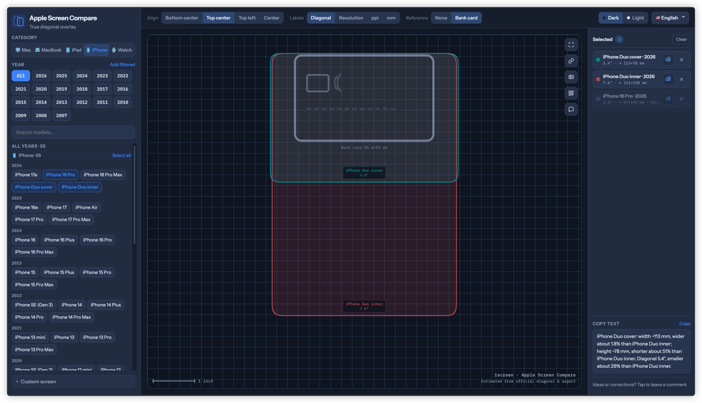
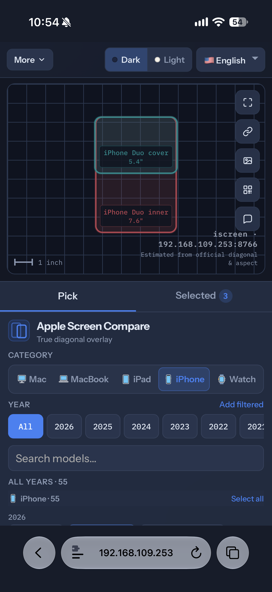
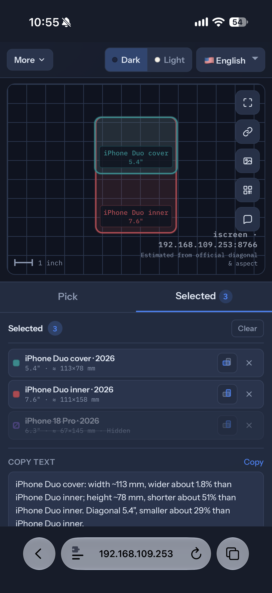
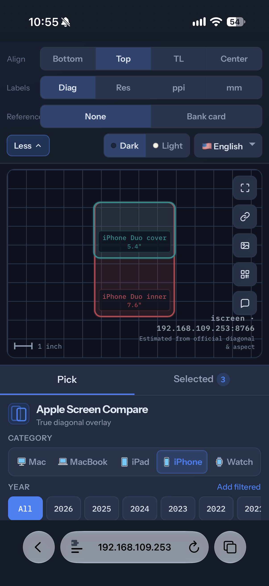
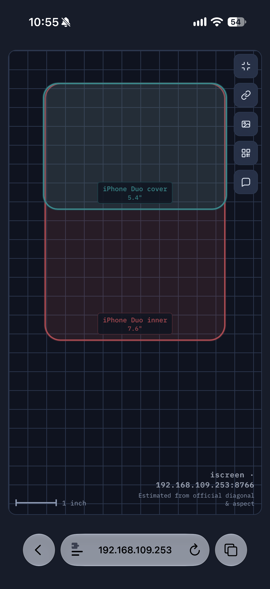

# iScreens

[中文](./README.zh-CN.md) · [English](./README.md)

When you’re buying a new phone or tablet, the difference between “6.3″” and “6.9″” looks tiny on the spec sheet—and you can’t always put the devices side by side. Spec tables don’t build intuition, and marketing renders each live in their own world.

So there’s [iscreens.cc](https://iscreens.cc): **iPhone, iPad, Watch, MacBook, and Mac** overlaid on one canvas at true diagonal scale, so you can see how much bigger or wider something really is. Got another display? Enter its diagonal and resolution as a custom screen and compare it too.

Flip portrait/landscape, tweak alignment, labels, and a bank-card reference; then export an image, copy a share link, or open the same comparison with a QR code.

## Features

- **Device library** — iPhone / iPad / Watch / MacBook / Mac, with year filters and search
- **True-scale overlay** — physical size estimated from official diagonal and aspect ratio
- **Custom screens** — diagonal + resolution for non-Apple or odd-size displays
- **Orientation & align** — per-device portrait/landscape; top-left / top-center / center / bottom-center
- **Labels & reference** — diagonal, resolution, ppi, mm; optional bank-card scale
- **Export & share** — PNG export, stateful share links, QR to the same setup
- **Theme & languages** — light/dark and multiple UI languages

## Screenshots

### Desktop

### Mobile

| Pick models | Selected |
|:---:|:---:|
|  |  |
| **Tools** | **Fullscreen compare** |
|  |  |

---

Apple and related marks belong to their owners. This project is not affiliated with Apple Inc.
