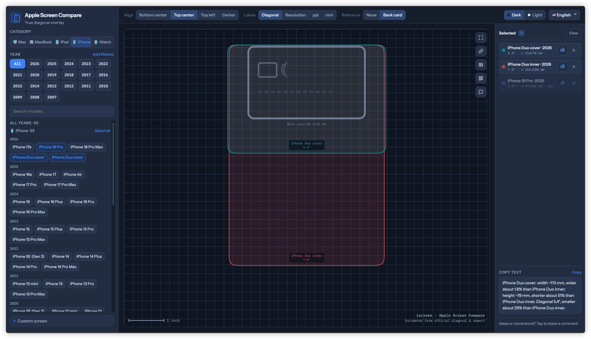
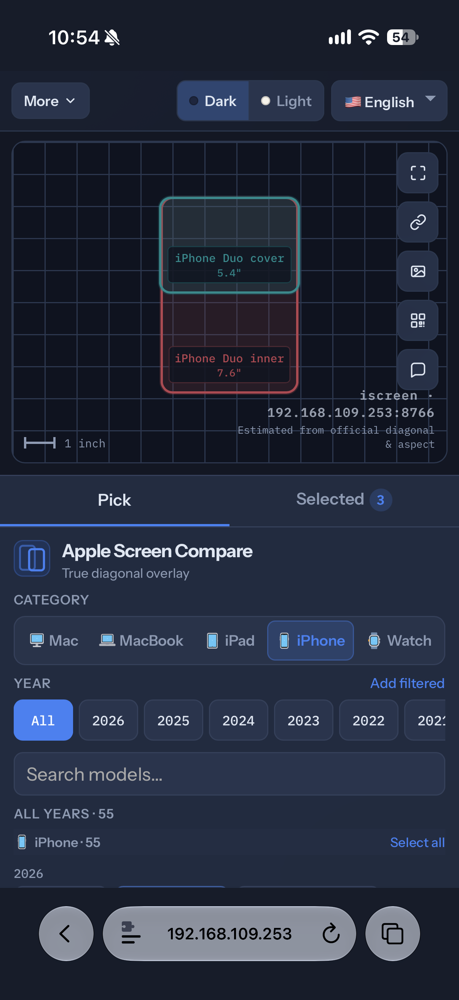
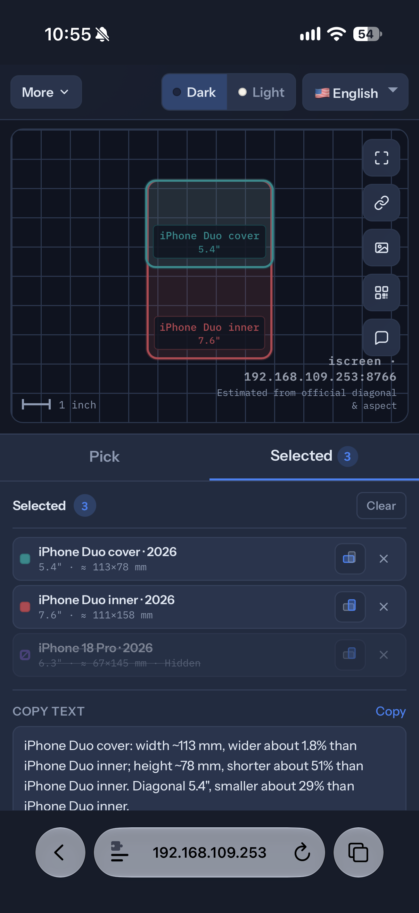
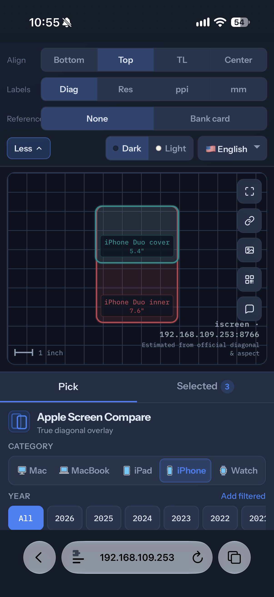
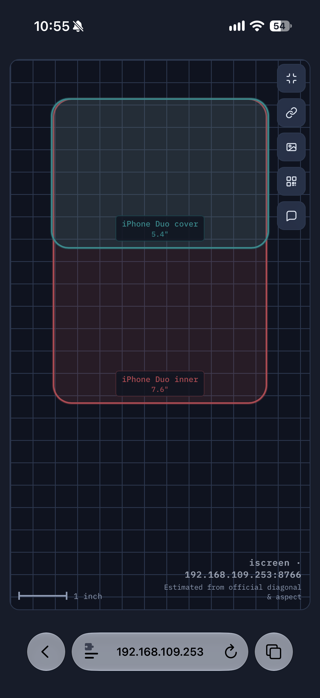

# iScreens

[中文](./README.zh-CN.md) · [English](./README.md)

买新手机、换平板的时候，说明书上的「6.3 英寸」「6.9 英寸」总是差那么一点，可手放在一起又不一定方便。参数表很难建立直觉，官方渲染图又各自为政。

于是做了 [iscreens.cc](https://iscreens.cc)：把 **iPhone、iPad、Watch、MacBook、Mac** 按真实对角线比例叠在同一张画布上，一眼看出到底大多少、宽多少。自家显示器或别的屏幕，也可以填对角线和分辨率，当成自定义设备一起比。

横竖可以拧，对齐、标注、银行卡参照物都能开；比完能导出图片，也能复制链接或扫二维码，丢给朋友一起看。

## 功能

- **多品类机型库**：iPhone / iPad / Watch / MacBook / Mac，可按年份筛选、搜索
- **真实比例叠放**：按官方对角线与长宽比估算物理尺寸，画在同一坐标系里
- **自定义屏幕**：填对角线和分辨率，和非标设备、显示器也能一起比
- **横竖与对齐**：单台切换朝向；顶左 / 顶中 / 居中 / 底中对齐
- **标注与参照**：对角线、分辨率、ppi、毫米；可选银行卡比例参照
- **导出与分享**：导出对比图、复制带状态的链接、二维码扫开同一组对比
- **深浅色与多语言**：界面主题可切换，并支持多种语言

## 截图

### 桌面端

### 移动端

| 选机型 | 已选 |
|:---:|:---:|
|  |  |
| **工具** | **全屏对比** |
|  |  |

---

Apple 及相关商标归其权利人所有。本项目与 Apple Inc. 无关。
